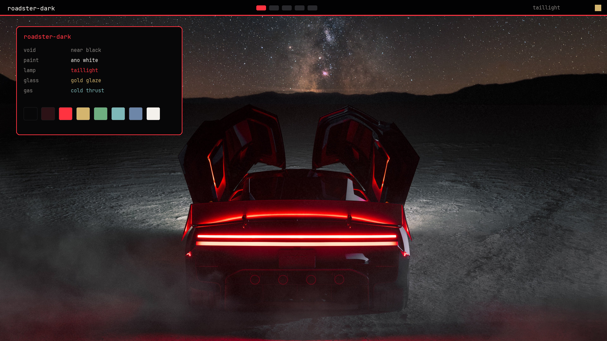

# Roadster Dark

The same Roadster, after dark. Near-black panels taken from the studio void, Ano White text, and the full-width taillight as the accent. A companion to [Roadster](https://github.com/IM0001GT/omarchy-roadster-theme) for [Omarchy](https://omarchy.org/).



Not affiliated with Tesla or SpaceX. The photographs stay Tesla's. See [NOTICE](NOTICE).

## Install

Open the Omarchy menu (`Super + Space`), choose **Install > Style > Theme**, and paste:

```
https://github.com/IM0001GT/omarchy-roadster-dark-theme
```

Or from a terminal:

```bash
omarchy theme install https://github.com/IM0001GT/omarchy-roadster-dark-theme.git
```

The theme shows up as **roadster-dark**. Cycle wallpapers with `omarchy theme bg next`.

## Palette

Every text color below clears WCAG AA on `#070708`.

| Role | Hex | From |
| --- | --- | --- |
| Background | `#070708` | The void behind the car |
| Dark background | `#050506` | Deeper shadow |
| Darker background | `#020203` | Near black |
| Lighter background | `#141416` | Raised surface |
| Foreground | `#f4f1ec` | Ultrawhite seats |
| Bright foreground | `#fbfbfb` | Ano White highlight |
| Accent | `#ff3340` | Full-width taillight |
| Selection | `#2c1216` | Taillight spill |
| Muted | `#8a8682` | Microsuede and titanium |
| Red | `#ff3340` | Taillight |
| Yellow | `#d4b56e` | Gold-glazed glass |
| Orange | `#c4846a` | Copper in the dark |
| Green | `#6eae80` | Status green, kept quiet |
| Cyan | `#7eb8b8` | Cold-gas thrusters |
| Blue | `#6d86a8` | Night atmosphere |
| Magenta | `#c47a90` | Red light on white paint |
| Brown | `#a18462` | Bronze spokes |

Window borders run taillight red into gold. Icons are `Yaru-red`. Keyboard glow is the taillight.

## Wallpapers

Thirty-five of the darker photographs from the Roadster set. Daylight desert frames and the bright white close-ups stay in the original theme. `01-night-taillight.jpg` is first.

Night and studio shots come first, then orbit and flight, then the dark cockpit and hardware frames.

Sources:

- [Tesla](https://x.com/Tesla/status/2110907035571401174) and [Out of this world](https://x.com/Tesla/status/2110965323054866905)
- [Sawyer Merritt](https://x.com/SawyerMerritt/status/2110912077816848877)
- [The Tesla Newswire](https://x.com/TeslaNewswire/status/2110959644982325319)
- [Chansoo](https://x.com/Chansoo/status/2110924789426831613)
- [Dirty Tesla](https://x.com/DirtyTesLa/status/2110927245241909568)
- [non aesthetic things](https://x.com/PicturesFoIder/status/2110962571474055302)
